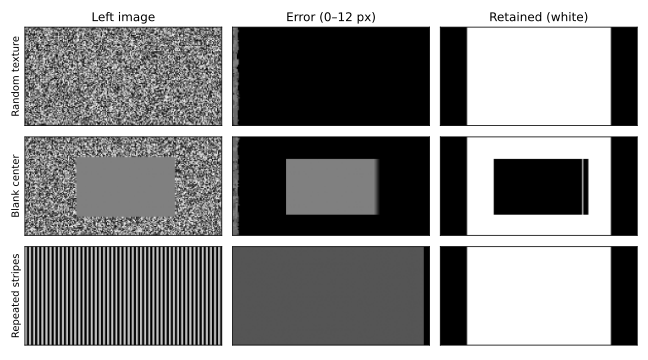
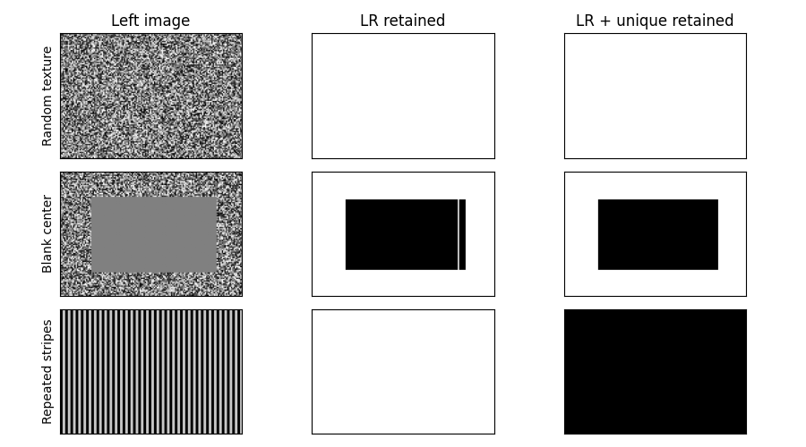

# When consistent stereo is wrong

These are controlled synthetic planes at 6 px disparity, not Middlebury scenes or a navigation evaluation. This standalone NumPy SAD baseline is separate from the package's Chess1 pipeline. Repeated stripes admit several equally good matches. Both views choose disparity 2 instead of 6: every evaluated pixel passes consistency despite a 4 px error.

[Measured CSV](results.csv) · [Generator and evaluation](benchmark.py)

Run `python benchmark.py` in this folder with NumPy and Matplotlib installed. Coverage is the retained fraction of the interior ROI (26 columns excluded per side). Positive disparities with left/right difference ≤1 px are retained. MAE is disparity error in pixels, not metric depth error. Timing is the median of five runs of both matchers and the filter, excluding data generation and plotting (x86_64, NumPy 2.3.5). It is not a device latency prediction.

## What if the best match is tied?

Run `python uniqueness.py` here to regenerate the figure and [paired results](uniqueness.csv). Using the same seed, scene order, matcher and interior region, the second filter also requires the second-lowest left matching cost to exceed the lowest. Ground truth is used only for scoring. All three LR-only coverage and error values reproduce the baseline at its reported precision.

On the blank-center scene 54 additional estimates are rejected; retained MAE falls from 0.0317 to 0 px. Random texture loses no pixels. On stripes every candidate pixel is rejected: coverage is zero and retained MAE is undefined, not zero. This rule flags exact ties only. Near ties in noisy real imagery and unique but wrong matches remain untested.
